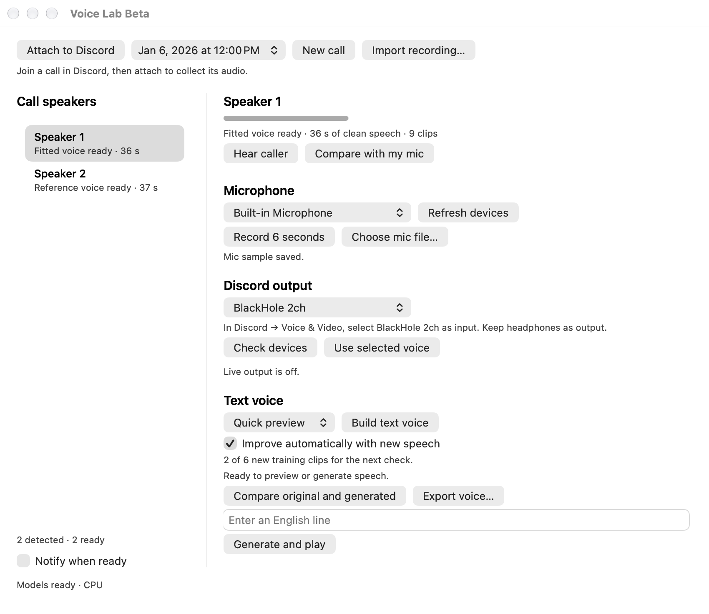

# Discord Kokoro Lab

Voice Lab is a Mac app that separates speakers in a recording. Preview how your mic sounds in a selected voice, use that voice live in Discord, or generate speech from typed English. Recordings and voice profiles stay on your Mac.

**[Download Voice Lab Beta for Mac](https://github.com/chandlerbrown4/discord-kokoro-lab/releases/latest/download/Voice-Lab-Beta-macOS-arm64.zip)** · [Release notes](https://github.com/chandlerbrown4/discord-kokoro-lab/releases/latest)

**[Hear the before-and-after demo](https://github.com/chandlerbrown4/discord-kokoro-lab/releases/latest/download/Voice-Lab-Before-and-After.wav)** using a synthetic mic take and a stock target voice.

**Requires a Mac with an Apple M-series chip and macOS 14 or later.** Check **Apple menu → About This Mac** for your chip and macOS version. The first launch downloads the tools and public speech models it needs, so connect to the internet and allow about 3 GB of free space. The app handles setup and shows its progress.

## Hear your first voice

1. **Open the app.** Double-click the downloaded ZIP, drag **Voice Lab Beta.app** into **Applications**, and open it. Wait for **Models ready**.
2. **Import a recording.** Try the synthetic practice recording. In the app, choose **Import recording…** and select the downloaded file. When a speaker is ready, select it and choose **Hear caller**. [Download the practice recording](https://github.com/chandlerbrown4/discord-kokoro-lab/releases/latest/download/Voice-Lab-Practice-Recording.wav)
3. **Try it with your mic.** Pick your microphone and choose **Record 6 seconds**. Allow microphone access if macOS asks. Select **Compare with my mic** to hear your recording first and the converted version second. This preview plays on your Mac.

You can also import your own recording up to two minutes and 16 MiB. Aim for 30 seconds of clear speech from one speaker across at least six excerpts. Record people with their agreement, and get their permission before recreating or using their voices.

### If macOS asks you to approve the app

This beta uses an ad hoc signature and can show an unidentified-developer warning. If you trust the download, try opening the app first. Then go to **System Settings → Privacy & Security → Open Anyway** and confirm. For setup progress or errors, open **Window → View Setup Log** in Voice Lab. [Apple’s app-opening guide](https://support.apple.com/en-us/102445)

## Use it in Discord

- **Capture a call.** Join the call in the Discord desktop app and choose **Attach to Discord** in Voice Lab. Allow screen and system audio recording when prompted. Capture continues if you close the window. When finished, choose **Stop capture** or quit Voice Lab.
- **Send a converted voice to the call.** In **Discord output**, choose **Open BlackHole installer** if you need a virtual cable. After installing, choose **Refresh devices**. Set **BlackHole 2ch** as the output in Voice Lab and the input in Discord’s **Voice & Video** settings. Keep your headphones as Discord’s output. Select a ready speaker and choose **Use selected voice**. When finished, choose **Stop output** and reselect your microphone as Discord’s input. [BlackHole](https://existential.audio/blackhole/) · [Discord voice settings](https://support.discord.com/hc/en-us/articles/33030151293079-Discord-Voice-Video-Streaming-Guide)

## Make a voice read typed text

Select a speaker with enough clear speech. Under **Text voice**, choose **Quick preview** and **Build text voice**. The first build downloads additional models and needs about 8 GB of extra free disk space. When it finishes, type an English line and choose **Generate and play**. Use **Save WAV…** to keep the result.

## Guides for developers

[Command-line and model workflows](docs/command-line.md) · [Build and verify the Mac app](packaging/macos/README.md) · [Opt-in Discord server bot](recorder/README.md)
